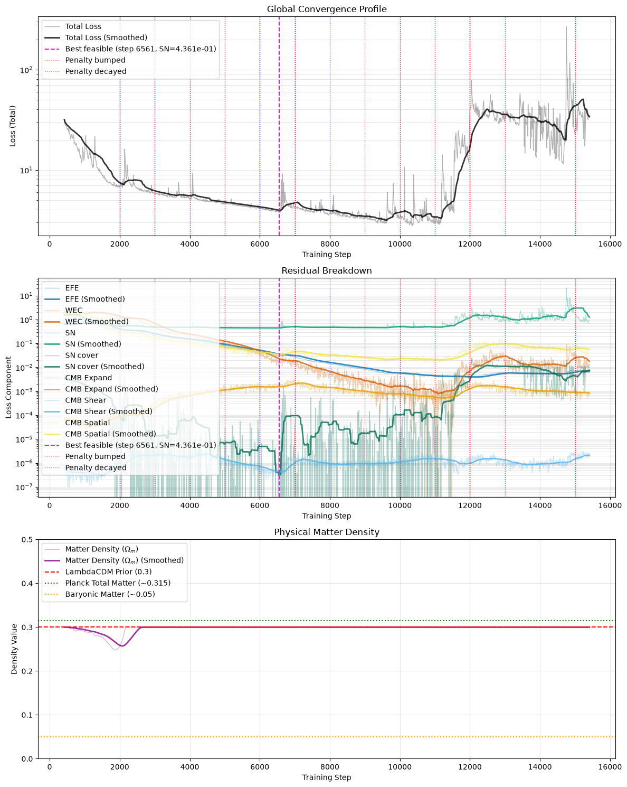
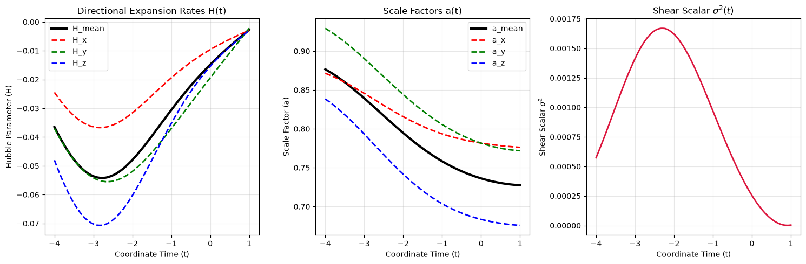
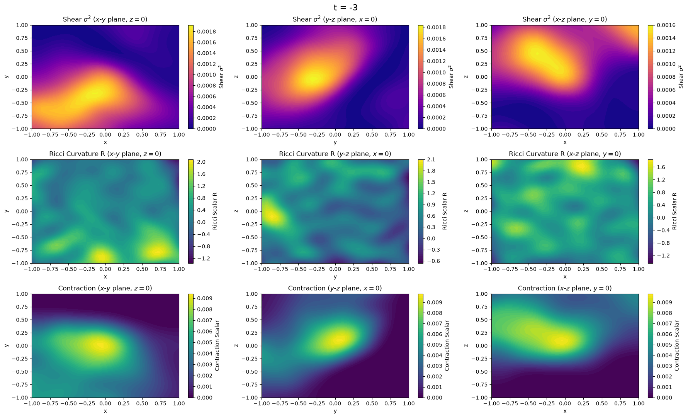
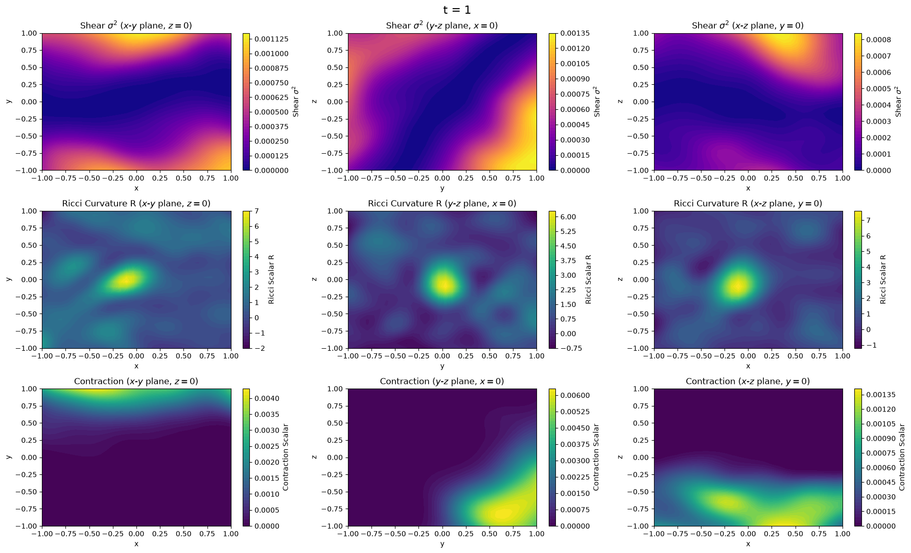

## Adding CMB constraints, at last

At the end of my [last post](/blog/lumpyspace4/), the neural network had found a
mathematically valid but physically unlikely contracting universe. The plan was
to immediately implement Cosmic Microwave Background (CMB) constraints to
provide a physical basis for the very early universe.

Before deploying those constraints, I made one small adjustment. To stitch them
together with the existing EFE-sampled spacetime, I needed to expand the time
sampling from $t=-3.9$ to $t=-3.99$.

I didn't expect much from that. I expected to spend this post writing about
anisotropic shear channels. Instead I spent it discovering that since day 1[^0]
the supernova data had never reached the model at all.

Here is the timeline.

### Pushing to $t = -3.99$

Expanding the coordinate sampling back to $t = -3.99$ pushed the network into
the extremely dense early universe. Physical density scales as
$\rho \propto a^{-3}$ so the Einstein Field Equation (EFE) residuals in this
region exploded.

To minimize that loss, the network took the path of least mathematical
resistance: it dropped the matter density parameter ($\Omega_m$) to the
baryonic floor ($\approx 0.05$). By turning the universe into a near-vacuum, it
zeroed out the density constraints entirely.

But without Dark Matter or Dark Energy, how was it still fitting the Supernova
acceleration data?

I assumed, and the data showed, that it cheated. It generated a metric with
**massive early shear**, using violent early-universe anisotropy as a physical
"engine" to drive late-time acceleration.

### Adding the CMB priors

That early shear is physically illegal. The Cosmic Microwave Background proves
the early universe was highly isotropic and homogeneous.

To shut the loophole I deployed Augmented Lagrangian boundary constraints in
the deep past ($t \in [-4.0, -3.99]$):

1. **Expansion Rate:** $H_i \ge 0$ (no contracting axes)
2. **Isotropy (Near-Zero Shear):** $\sigma^2 \le 10^{-5}$
3. **Homogeneity (Near-Zero Spatial Gradients):**
   $\sum (\partial g)^2 \le 10^{-5}$

Enforcing CMB isotropy took away the network's engine without undermining the
goal of the project. Forced to be isotropic in the early universe, the network
_had_ to rely on Dark Matter ($\Omega_m = 0.3$) to balance the EFE. But in
standard General Relativity, a universe filled only with matter **must
decelerate**.

Faced with forced deceleration, the optimizer fell right back into the local
minimum of a collapsing universe to brute-force the Supernova chi-squared fit.

### The symmetry breaking problem

If late-time lumpiness (backreaction) is a possible physical alternative to
Dark Energy, why wasn't the network finding it?

The answer lies in how neural networks initialize. A standard MLP initializes
with tiny, near-zero weights. Because our metric components are defined as
$g_{ii} = \exp(\text{NN}_i)$, the initial state maps almost exactly to flat,
empty Minkowski space, even with $\sim 10^{-4}$ noise.

In Minkowski space the expansion rate is exactly zero, the spatial gradients
are exactly zero, and it is perfectly homogeneous. Because the Einstein Field
Equations are highly non-linear, that perfectly homogeneous state acts as a
massive mathematical saddle point. The optimizer looks at the local gradients,
sees no spatial variance to exploit, and scales the entire metric uniformly
down the contracting branch.

The network cannot build a lumpy universe because it starts too perfectly
smooth to ever find the gradients required to build lumps.

The fix came from the [SIREN](https://arxiv.org/abs/2006.09661) architecture we
had already adopted. A SIREN multiplies the first layer's coordinates by a
high-frequency scalar $\omega_0$, so the network initializes as a superposition
of high-frequency ripples. That is the mathematical equivalent of seeding the
universe with a primordial power spectrum of density perturbations.

I chose a conservative $\omega_0 = 10.0$ rather than image-processing defaults of
30, to avoid an initial curvature explosion that would blow up the
EFE residuals. It seeds supercluster-scale gradients while keeping the initial
curvature inside the optimizer's stable bounds.

## Anchoring the fluid

While hunting the symmetry breaking problem I found a quieter bug in the
physics loss.

Falling back on FLRW and diagonal metric intuition, I had simplified the
pressureless matter Stress-Energy tensor. I set the energy density component as
$T_{00} = \rho(-g_{00})$, left every off-diagonal entry zero, and converted to
mixed form by contracting with the inverse metric.

For perfectly diagonal metrics where $g_{0i} = 0$, that is harmless. When the
PINN explores arbitrary 4D spacetimes with non-zero shift components
($g_{0i} \neq 0$), it becomes a bug. The inverse metric $g^{\mu 0}$ carries
off-diagonal elements, so multiplying by the naive $T_{00}$ injects phantom
momentum fluxes:

$$T^i_0 = -g^{i0} g_{00} \rho \neq 0$$

and simultaneously corrupts the rest-frame energy density:

$$T^0_0 = -g^{00} g_{00} \rho \neq -\rho$$

The entire physical premise of this project rests on matter being strictly
**comoving** ($u^i = 0$). Galaxies ride along with the expansion grid; they do
not move relativistically through coordinate space. That assumption is what
justifies the geometric density dilution law
($\rho \propto 1/\sqrt{\det(g_{ij})}$) and guarantees that the redshifts tracked
by the ray-tracer represent true metric expansion.

Leaving the bug in place handed the network a convenient cheat: by generating
non-zero coordinate shifts, the optimizer could fabricate fictitious matter
currents to bypass the EFE residual.

The fix is the first-principles definition. With $u^i = 0$, the exact
4-velocity is

$$u^\mu = \left(\frac{1}{\sqrt{-g_{00}}}, 0, 0, 0\right)$$

and lowering the index gives the exact mixed tensor

$$T^0_0 = -\rho, \qquad T^0_i = \rho \frac{g_{0i}}{-g_{00}}, \qquad T^i_0 = 0, \qquad T^i_j = 0$$

I implemented that directly in the EFE loss, which eliminated the phantom
momentum fluxes and pinned $T^0_0$ to $-\rho$.

## The result that didn't add up

With symmetry broken and the fluid anchored, I let it run. And the numbers were
wrong in a way I couldn't explain.

$\Omega_m$ sat pinned at the $0.05$ floor. $H_{\text{mean}}$ came out around
$-0.003$ in code units, where $H_0 = 73$[^1] should be $\approx 0.2435$. Two
orders of magnitude too small, and negative.

Then I looked properly at the supernova loss. `l_sn` is a **mean** of squared
standardized residuals, which is to say a reduced chi-squared. A good fit sits
at $\approx 1$. Mine sat at $\sim 86$, and its best value across the entire run
was $\sim 29$. Every supernova in Pantheon+ was sitting five to nine $\sigma$
from the model's prediction.

That is not a fit. And I had been reading those numbers for months as though
they meant something.

### Where the light never got to

The ray-tracer integrates null geodesics backwards from the observer until it
accumulates the target redshift for each supernova. So I instrumented it and
asked how far a ray actually gets.

```text
 pctile  z_target  max_z_found  short?    sol.t1
      0    0.0012      0.00002    True  -10.0000
     50    0.1636      0.00002    True  -10.0000
     99    1.2359      0.00002    True  -10.0000
    100    2.2613      0.00002    True  -10.0000
```

Every ray, across the entire affine path, accumulated a total redshift of
$2 \times 10^{-5}$. The nearest supernova in the catalogue sits at $z=0.0012$,
sixty times beyond reach. **One hundred percent of Pantheon+ was unreachable.**

So what had `get_luminosity_distance` been returning for four months?

When the integration cannot reach the target, `jnp.interp` clamps to the end of
the trajectory, and a shortfall penalty I had added to push the optimizer
toward expansion gets added on top:

```python
penalty = jnp.where(max_z_found < z_target, 10 * (z_target - max_z_found), 0.0)
return (result + penalty) * L_UNIT
```

With `max_z_found` pinned near zero, that reduces to

$$d_L \approx 10^4 z - 105 \ \text{Mpc}$$

a straight line in the **target** redshift, offset by a near-constant term from
the geometry. Checking it against the real returns: at $z=0.0030$ the function
gave $-75.3$ Mpc against the formula's $-75$; at $z=0.0199$, $94.1$ against
$94$; at $z=0.0283$, $177.7$ against $178$.

The luminosity distance contained no distance-redshift physics whatsoever. It
was a linear function of the number I passed in.

### Why it survived for months

Three things conspired to keep it quiet.

The penalty was scaled to look plausible. At $z=1$ it produces
$\mu \approx 44.8$ against a real value of $44.1$ — wrong by an amount that
reads as a mediocre fit rather than a catastrophic failure.

Negative distances were silently absolved. The interpolation ran over a
non-monotonic redshift array, which `jnp.interp` does not support and does not
warn about, and it duly returned negative "distances". Those were then
rectified by an `jnp.abs()` in the distance modulus calculation.

And the penalty term looked like diligence. A penalty term whose comment says
it exists to drive expansion reads, at a glance, like me being careful.

## Minkowski is the problem

Once I understood what `l_sn` had been measuring, a more uncomfortable question
followed: what had been holding the geometry up at all?

So I checked what empty flat space scores on each term in the loss.

| term | at Minkowski | why |
| --- | --- | --- |
| $\mathcal{L}_{\text{phys}}$ | **0** | $G_{\mu\nu}=0$, and `kappa_rho_0 = omega_m * 3 * h_mean**2` zeroes the stress-energy at $H \to 0$ whatever $\Omega_m$ says |
| $l_{\text{wec}}$ | **0** | $R = 0$ |
| $l_{\text{expand}}$ | **0** | $H_i = 0$, so $\max(0, -H_i)^2 = 0$ |
| $l_{\text{shear}}$ | **0** | $\sigma^2 = 0 \le 10^{-5}$ |
| $l_{\text{spatial}}$ | **0** | no spatial gradients |

Empty static space is a **global minimum of every physics term in the
objective**. Every constraint I spent two posts building (Augmented
Lagrangian, the adaptive penalty scheduler, CMB priors) is perfectly
satisfied by a universe containing nothing and doing nothing.

The supernova data was the only term in the entire loss capable of pushing the
metric off Minkowski. And that was the broken term.

That single fact retroactively explains everything else. $\Omega_m$ dropping
to the floor: with $H \approx 0$ there is no matter regardless of $\Omega_m$,
so nothing pushed back. The collapsing universe: nothing was holding the
expansion up. The constraints that refused to improve under escalating
penalties: they were being dragged off their comfortable Minkowski values by
the lumpiness pressure, and fighting to return.

Three separate mysteries across three posts, all the same one.

## One ray for seventeen hundred supernovae

While repairing the channel I found a second problem, less a bug than a
simplification I had never revisited.

```python
initial_k = jnp.array([kt, kx, 0.0, 0.0])
```

Every supernova was traced along $+x$. All 1701 of them, wherever they actually
sit on the sky, differing only in how far along that one ray the integration
ran.

The model's geometry is genuinely four-dimensional and anisotropic, which is
the entire thesis of this project, and the data was only ever probing a single
line through it. The network was free to put whatever it liked everywhere else,
because nothing observed it.

Pantheon+ ships RA and Dec for every supernova and I had simply never loaded
the columns. Its sky distribution carries a dipole of magnitude $0.28$, so
those directions hold real angular structure.

Firing each ray along its own direction also required fixing the null
normalization. The old code solved $g_{00}k_t^2 + g_{11}k_x^2 = 0$, ignoring
the shift terms $g_{0i}$, so the initial ray stopped being null the moment the
metric developed off-diagonal time-space components. The general case is a
quadratic in the spatial magnitude $s$ along a direction $\hat{n}$:

$$\left(g_{ij}n^i n^j\right)s^2 - 2k_t\left(g_{0i}n^i\right)s + g_{00}k_t^2 = 0$$

## Separating the two questions

The repair is to stop letting one number answer two questions.

`get_luminosity_distance` now returns `(dL, z_reached)` and doesn't invent a
value for an unreachable target. The loss splits to match:

- `l_sn` is the chi-squared over reachable supernovae, with a **fixed**
  denominator of the full catalogue. Unreachable sources contribute zero to the
  numerator while still counting in the denominator, so a badly-fitting
  supernova cannot be shed by making it unreachable.
- `l_sn_cover` is the mean redshift shortfall, a hinge that reads exactly zero
  once every ray reaches its source.

`z_reached` is the redshift at the last finite state of the trajectory rather
than the maximum anywhere along it, which would reward a ray that redshifts
briefly and then blueshifts back.

## Results

The channel reconnected immediately. The mean redshift shortfall collapsed from
$0.25$ — effectively the mean redshift of the catalogue, since nothing was
reachable — through $9\times10^{-2}$, $1.7\times10^{-2}$, $8.4\times10^{-3}$,
$3\times10^{-3}$, and kept going. By step $1870$ it was touching exactly zero.
The supernova chi-squared fell alongside it, from the fabricated $29$–$86$ range
to under $0.5$ per supernova.



The end of the chart is the run breaking down. As the penalties kept
escalating, the fit fell apart from step $11{,}500$, and at step $15{,}390$ a
single ray failed in the ODE solver and stopped the run.

$\Omega_m$ went the other way from the earlier runs: after a brief dip it hit
its $0.3$ ceiling around step $2200$ and stayed there for the rest of the run.

### Reaching the whole catalogue

`l_sn_cover` first reads exactly $0$ at step $1870$. Until the run broke down,
it was exactly zero on just over half of all logged steps. On those steps every
ray in the catalogue reaches its source, out to the most distant supernova at
$z = 2.26$. Between them the shortfall is mostly below $10^{-4}$, the last
handful of supernovae crossing in and out of reach as the geometry churns. It
spikes when the geometry is disturbed: the largest before step $11{,}000$,
$4\times10^{-3}$ at step $2140$, is still only a sixtieth of where it started.

The coverage weight is what pins it there. At $w_{\text{sn\_cover}} = 2000$, a
mean shortfall of even $3\times10^{-3}$ costs $6.0$, which makes it the largest
single term in the objective. Combined with the fixed $\chi^2$ denominator,
which keeps an unreachable supernova counting against the fit, there is no
cheap way to give up the far tail.

The supernova fit settles at a reduced $\chi^2$ of $0.436$ at its best. That is
below $1$, which means the residuals are smaller than the Pantheon+ error bars
would lead you to expect: a flexible network fitting 1701 points, conservative
quoted uncertainties, or some of both.

### Fitting through the wrong door



The fit is genuine, and expansion plays almost no part in it. Along the
observer's line the mean expansion rate is negative across the entire history,
today included: about $-0.0025$ at $t = 1$, where $H_0$ is $0.2435$. The model
universe is contracting now. The deep past contracts hardest, bottoming out
around $t \approx -2.8$, and over the whole history the mean scale factor
shrinks by $17\%$. Every bit of the supernova redshift has to come from
$\sqrt{|g_{00}|}$.





The maps across space show how. At $t = -3$ the contraction is a single region
centred on the observer. By today it has moved out to the edges of the box,
and at the observer sits a lump of positive curvature, $R \approx 7$, about
$0.3$ across. For pressureless matter $R = \kappa\rho$, and the model's
$\kappa\rho$ is around $10^{-5}$, so nothing sources the lump: the field
equations are not balanced there. It is small enough that the randomly sampled
field-equation loss rarely lands in it. It also sits exactly where every ray
starts, which makes it the obvious place for $\sqrt{|g_{00}|}$ to be doing the
work.

## What this cost, and what it bought

For four months the supernova data never reached the model. The figures and
numbers in parts 3 and 4 were produced under that broken channel and should be
read accordingly.

With the channel repaired, every supernova in Pantheon+ is reached and the fit
is genuine. It is also a fit through the wrong door: a universe that contracts
today, gets its redshift from an unsourced lump of curvature around the
observer, and breaks the CMB's isotropy by orders of magnitude. The CMB
penalties that should have caught it were measuring the wrong things.

## Next

Three changes come out of this run.

### Matter that can push back

One thread from the Minkowski table is worth pulling.

`kappa_rho_0 = omega_m * 3.0 * h_mean_today**2`. The matter density is
_derived_ from the expansion rate, so $H \to 0$ forces $\rho \to 0$ whatever
$\Omega_m$ holds. Matter can never be a reason for the universe to expand,
because there is no matter unless it is already expanding.

Make the free parameter an absolute density $\rho_0$ and flat static space with
$\rho_0 > 0$ produces a non-zero EFE residual, where the only way down is to
curve. "There is matter here" becomes incompatible with "there is nothing
happening", which is the physically true statement.

$\Omega_m$ then becomes a quantity the fit _reports_ rather than a tuning knob
clipped to $[0.05, 0.3]$; considerably more tabula rasa than where this project
currently stands.

### Where the redshift comes from

There is a second thread, and it runs the opposite way.

A healthy `l_sn` says the model reproduces the observed distance-redshift
relation. It says nothing about the mechanism. Redshift in a general metric has
two sources: the expansion of space, and the gravitational potential through
$\sqrt{|g_{00}|}$. The ray-tracer measures their sum, and the supernova loss
constrains their sum. Either one on its own can satisfy it.

So the model can fit Pantheon+ with $H_{\text{mean}}$ two orders of magnitude
below $H_0$, or even below zero, provided $\sqrt{|g_{00}|}$ carries the load.
That is a degenerate basin, and nothing currently in the objective excludes it. It is the part-4
degeneracy again, in a sharper form: back then the supernova channel was broken
and the geometry was unconstrained. Now the channel works, the geometry fits,
and it fits through the wrong door.

The constraint that closes it is a band on $H_{\text{mean}}$ at $t=1$: 60 to 80
km s⁻¹ Mpc⁻¹, or $[0.200, 0.267]$ in code units. A two-sided hinge, exactly zero
inside the band, joining the existing Augmented Lagrangian set.

Adding an observational band to a project whose entire premise is assuming
nothing deserves some scrutiny, so it is worth being precise about what we're
assuming.

The SH0ES value is a local distance ladder. Geometric anchors (parallaxes, the
NGC 4258 maser, detached eclipsing binaries in the LMC) calibrate Cepheids,
Cepheids calibrate Type Ia absolute magnitudes, and $H_0$ is the slope of
velocity against distance for supernovae between $z = 0.01$ and $z = 0.15$.
Distances come from stellar physics and geometry. Redshifts come from
spectroscopy. Homogeneity enters through the peculiar-velocity corrections and
the local density contrast, both bounded at the one-to-two percent level. The
Planck figure of $67.4$ is a model-dependent one, inferred from the sound
horizon under full $\Lambda$CDM.

The band also adds no information the data does not already carry. The slope of
$\mu(z)$ in Pantheon+ **is** $H_0$. The model is already being told, 1701 times
over. What the band changes is which channel is permitted to carry the message.

And there is a cleaner way to see why this concedes nothing. The question here
is whether inhomogeneity can account for cosmic **acceleration** without dark
energy. Whether the universe expands at roughly 70 km s⁻¹ Mpc⁻¹ was never the
contested part, $\Lambda$ is. Pinning the expansion rate gives up nothing that
was under test, and frees the optimizer to work on the part that is.

Which does leave an obvious tension: one of these changes removes a clamp and
the other adds one. The balance is that clipping $\Omega_m$ constrains what the
universe is **made of**, which is precisely the thing this project set out to
interrogate. A band on $H$ constrains how fast it **expands**, which has been
measured directly and was never in dispute. Ideally we would have found a
solution from which the measured $H_0$ would align with observation, but that's
apparently an expensive solution!

The two meet in the same place regardless. $\kappa\rho_0 = \Omega_m \cdot 3H^2$
means a collapsed $H$ starves the matter density, and a universe with no matter
in it has no reason to expand. An absolute $\rho_0$ breaks the coupling; a band
on $H$ removes the basin. Run both and the optimizer should have nowhere
comfortable left to sit except a universe that contains matter and expands at
the rate we observe.

That also settles where the CMB constraints apply. By construction $t = -4$ is
the big bang, and those constraints sit just after it, where the CMB was
emitted. That only holds if the geometry honours the time coordinate, and this
one does not: in the learned spacetime the $t = -4$ slice is larger than
today's universe, and colder. The constraints are in the right place; the
universe they constrain never expanded away from it. A universe that contains
matter and expands is one where the geometry and the label agree.

### Holding the early universe to the CMB

The CMB constraints sit at the start of time, and they exist to forbid exactly
the early universe this run built. Through the deep past the region around the
observer contracts on every axis, and at the boundary the shear runs from about
twice the expansion rate early in the run to about two-thirds of it in the
geometry shown above. The CMB holds that ratio below $10^{-5}$.

They were slow to push back, for three reasons. Their tolerances are absolute
numbers in code units, so they do not scale with the expansion rate the shear
is supposed to be measured against. The losses square the violation, which
crushes a miss of $10^{-3}$ down to $10^{-6}$, too small to produce much
gradient. And the adaptive penalty weights only escalate on a schedule: the
expansion weight was raised five-fold at each check while the contraction kept
growing, and it took until step $7000$, at a weight of $15{,}625$, before the
contraction started to give way. The expansion loss then fell by about
$60\%$, while the supernova fit got worse.

The fix is to express them the way the CMB measures them: shear and
contraction as fractions of the expansion rate, metric variation as a
perturbation amplitude, tolerances at $10^{-5}$, and violations that stay large
when they are large.

Those are next.

[^0]: or $t=0$ i suppose.
[^1]: [_A Comprehensive Measurement of the Local Value of the Hubble Constant with 1 km s$^{-1}$ Mpc$^{-1}$ Uncertainty from the Hubble Space Telescope and the SH0ES Team_](https://arxiv.org/abs/2112.04510)
