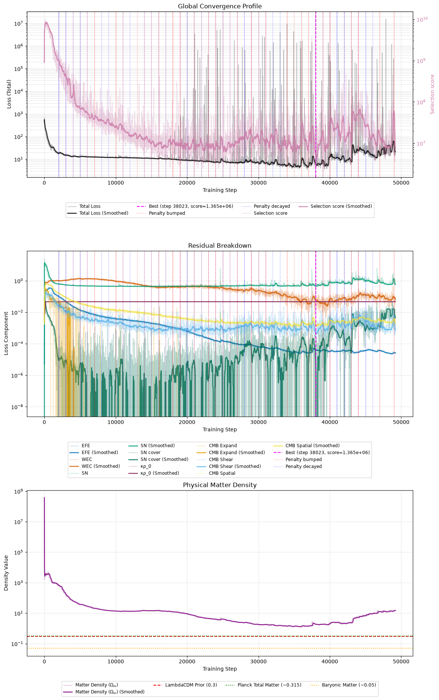
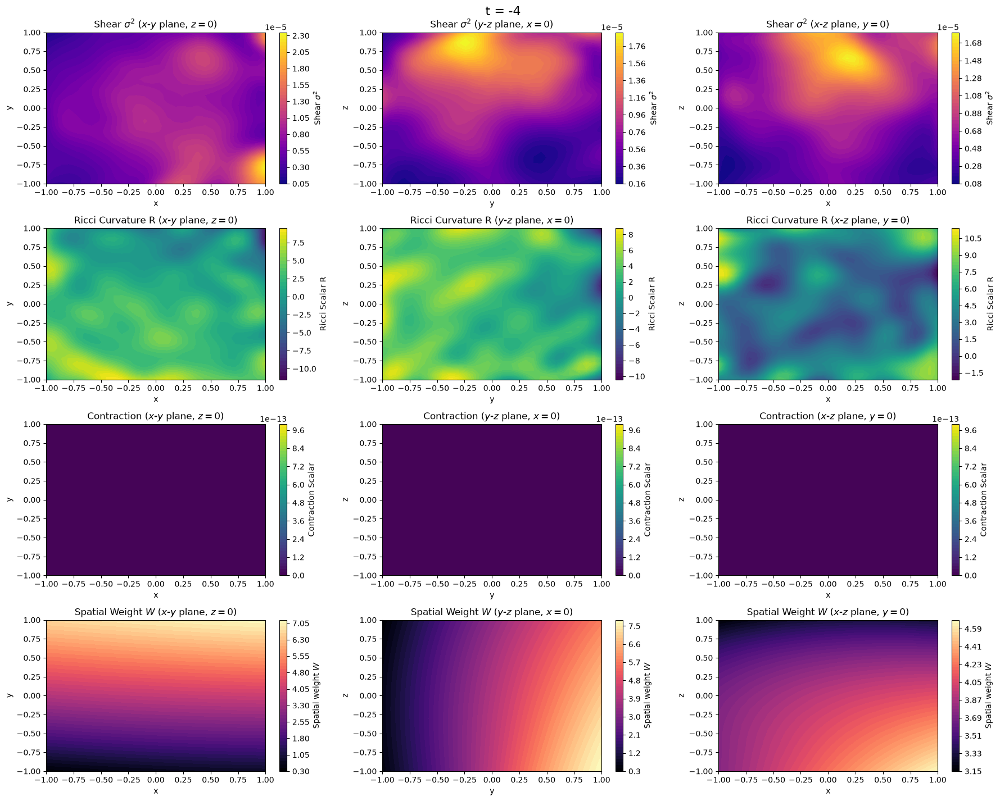
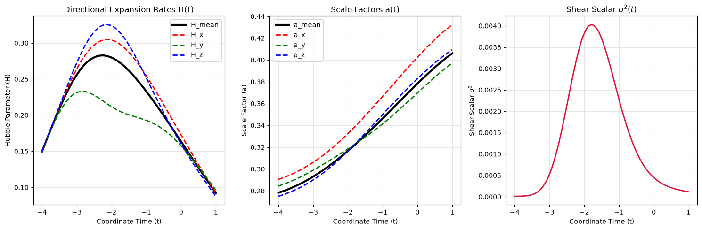
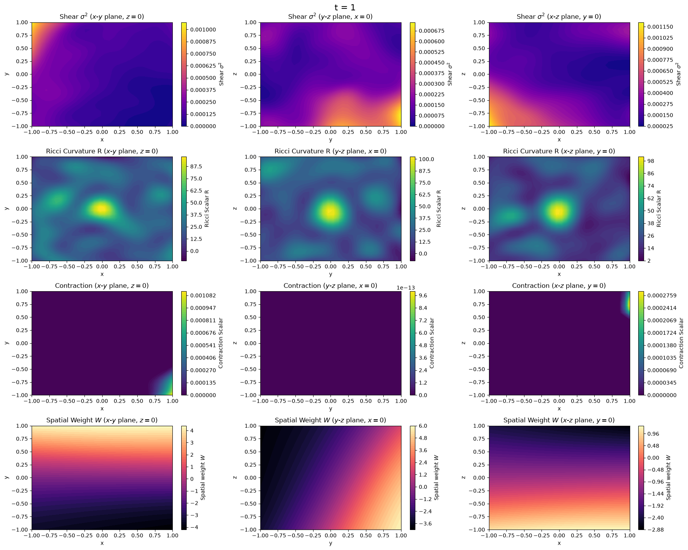
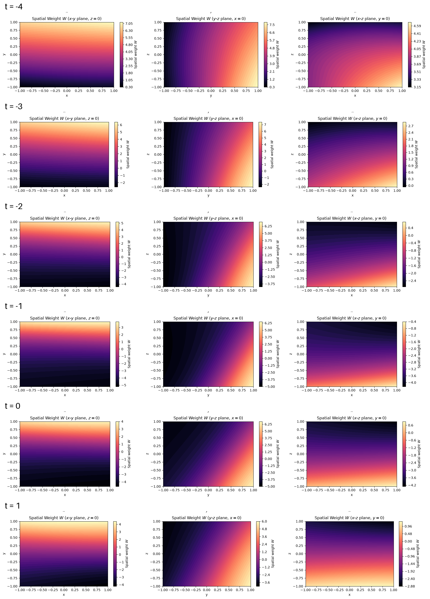

## Matter, and the early universe

At the end of my [last post](/blog/lumpyspace5/), the supernova data was
finally reaching the network, and the geometry it fitted that data with had
three problems. The mean expansion rate today was negative, about $-0.0025$ in
code units against an observed $H_0$ of about $0.24$. The supernova redshift
came almost entirely from the lapse $\sqrt{|g_{00}|}$, a gravitational
potential centred on the observer, and not from expansion. And at the boundary
where we apply the Cosmic Microwave Background (CMB) constraints, the shear was
between two-thirds of and twice the expansion rate, where the CMB bounds it
below $10^{-5}$.

This run made two changes. The matter density is now trained as an absolute
density, bounded by the observed baryon and total matter densities, where
before it was derived from the expansion rate. And the CMB constraints now
measure shear and contraction as fractions of the expansion rate, and metric
variation as a perturbation amplitude, each held to $10^{-5}$ from the first
step. Both changes worked. The run also showed that the spatial weighting
introduced in [part 3](/blog/lumpyspace3/), a learned weight on the
field-equation and energy-condition losses at each point, had been scaling
those losses down by factors of up to $10^6$.

### An absolute matter density

Until now the matter density was tied to the expansion rate:

$$\kappa\rho_0 = 3\,\Omega_m H^2$$

A universe with $H \approx 0$ had no matter in it, and so no reason to expand.
That was the hole the network sat in at the end of part 5.

So the trained parameter is now the absolute density $\kappa\rho_0$, bounded
between two physical densities: the baryons, which Big Bang nucleosynthesis
fixes from deuterium abundances and the CMB temperature, and the total matter.
Neither bound refers to $H_0$. $\Omega_m$ becomes something the fit _reports_
instead of something we clip.

With a density bounded away from zero, flat empty space no longer satisfies the
field equations. The time-time component of the Einstein Field Equations (EFE)
is the Friedmann constraint:

$$3H^2 - \sigma^2 + \tfrac{1}{2}{}^3R = \kappa\rho$$

Put matter on the right and something on the left has to balance it: expansion
($H$), shear ($\sigma$), or spatial curvature (${}^3R$).

### Holding the early universe to the CMB

The CMB constraints from part 5 were too weak to matter, for three reasons.
They squared their violations, so a miss of $10^{-3}$ registered as $10^{-6}$.
Their tolerances were absolute numbers, when the CMB constrains shear and
contraction _relative to_ the expansion rate. And they started at a weight of
1, gaining strength only when the adaptive scheduler bumped them, once every
thousand steps.

Before rewriting them, I asked whether they should stay Augmented Lagrangian
constraints at all. They should. Part 3 showed that a fixed-weight penalty lets
the network keep a little violation and pay the price; the Lagrange multiplier
$\lambda$ keeps raising that price until the violation is gone. Part 4 showed
that a fixed penalty weight settles into the same compromise one level up,
which is what the adaptive scheduler is for.

What changed is how they measure, and how hard they start:

- **Shear** as $\sigma^2 / (H^2 + \sigma^2)$, which is $(\sigma/H)^2$ while the
  shear is small and approaches 1 when shear dominates.
- **Contraction** as the share of the squared directional expansion rates that
  is contraction, between 0 and 1.
- **Homogeneity** as the amplitude of the metric's spatial variation per Gpc.

Each is a linear hinge at the CMB's $10^{-5}$, starting at a weight where a
full violation costs about as much as a mediocre supernova fit. We started weak
before because a physics-heavy start used to collapse the network into flat,
empty Minkowski space, which satisfies every physics term for free. With an
absolute matter density, Minkowski isn't free any more.

The energy condition stays on part 3's linear form, $\max(0, -R)$, at part 3's
starting weight of 10. I did try turning it into a fraction like the others,
and learned why part 3 made it linear: the curvature here is a hundred times
the matter term, so the fraction sat at 1 wherever $R < 0$ and stopped pushing
exactly where the violation was largest.

## The results

The run went for 49,000 steps. Everything below comes from its best
checkpoint, at step 38,023.

Three things stand out in the residuals. The CMB terms (yellow, gold and light
blue) fall straight away. The energy condition (dark orange) sits near 1 for
the first ten thousand steps, through every penalty bump. And the
field-equation residual (blue) keeps falling for the entire run, by more than
three orders of magnitude.

### The early universe, fixed

The CMB constraints worked at their starting weight, before the scheduler had
touched anything. Within a few thousand steps the boundary at $t = -4$ was
expanding on every axis at nearly the same rate, and it stayed that way.

For comparison, here's the same slice at the end of part 5:

- **No contraction anywhere.** The contraction maps are flat zero, and the
  contraction loss reads exactly zero on almost every step after the first five
  thousand.
- **Shear about 1% of the expansion rate.** In part 5 it was between
  two-thirds of and twice the expansion rate at the boundary.
- **The metric's spatial variation** fell from about $0.5$ to about $0.001$ per
  Gpc.

That's still a long way from the CMB's $10^{-5}$, and shear is now nearly all
of what keeps the score from improving. But the early universe now looks like
an early universe: smooth, isotropic, and expanding.

### Expansion

For the first time in this project, the universe expands at a meaningful
fraction of the observed rate. Along the observer's line, every axis expands
throughout the history, the mean scale factor grows by 46%, and $H$ today is
$0.092$ in code units: 39% of 70 km s⁻¹ Mpc⁻¹. At its peak, around step
35,000, it reached 45%.

The matter density went straight to its ceiling, the total observed matter,
within the first few hundred steps and stayed there. So the falling $\Omega_m$
in the bottom panel of the loss chart is $H$ rising: $\Omega_m$ is matter
relative to the critical density $3H^2/\kappa$.

The field equations say what it would take to get the rest of the way. Their
time-time component holds at every point, with no assumption of flatness or
isotropy:

$$3H^2 = \kappa\rho + \sigma^2 - \tfrac{1}{2}{}^3R$$

At the observed $H_0$, the left-hand side is about $0.16$ in code units. Matter
at its observed maximum supplies $\kappa\rho \approx 0.047$ of that, about 29%.
The other 71% has to come from shear ($\sigma^2$) or negative spatial
curvature (${}^3R < 0$). $\Lambda\text{CDM}$ sets both to zero and fills the gap with
a cosmological constant. Here the network has only the geometry to fill it
with, and whether the geometry can is the question this project exists to
ask.

### A shape that shouldn't exist

Look at the shape of $H(t)$. It rises from the boundary to a peak around
$t \approx -2.2$, then falls into today.

The falling half is ordinary deceleration. The rising half shouldn't be there.
Raychaudhuri's equation gives the rate of change of the matter's expansion
$\theta$:

$$\frac{d\theta}{d\tau} = -\tfrac{1}{3}\theta^2 - \sigma^2 + \omega^2 - R_{\mu\nu}u^\mu u^\nu + \nabla_\mu a^\mu$$

For pressureless dust that satisfies the field equations,
$R_{\mu\nu}u^\mu u^\nu = \tfrac{1}{2}\kappa\rho > 0$, and the dust falls freely,
so $a^\mu = 0$. That leaves rotation, $\omega^2$, as the only term that can push
the expansion rate up, and it would have to outweigh everything else put
together. The shift terms in our metric do allow the matter to rotate, and I
haven't measured how much. The simpler reading is that a rising $H$ marks a
stretch of history where the field equations don't hold.

Keep that in mind. It comes back below.

### Today

The CMB constraints act at $t = -4$. Today, only the field equations act on the
geometry, and the slice shows it. The observer still sits on a lump of positive
curvature, $R \approx +100$, thousands of times the matter term. Part 5 found
the same lump, smaller. It's about $0.15$ across, so on any step only a couple
of the thousand points where we check the field equations land in it. It's also
exactly where every light ray starts, which makes it the obvious suspect for
where the supernova redshift is really coming from.

## The volume knob

One constraint behaved differently from the others. The energy condition sat
near 1 for ten thousand steps while the scheduler raised its weight a
thousandfold and its multiplier climbed past 60,000. At one point the
multiplier alone should have added about 29,000 to the loss; the total loss
moved from 12.3 to 12.9. The CMB contraction constraint, at a weight of 100,
had fallen by more than half in its first thousand steps.

Something was absorbing the penalty, and I'd built it.

### The lazy optimizer, again

In part 3 we tried homoscedastic uncertainty weighting, which gives each loss
term a learnable weight $W$ and minimises

$$\tfrac{1}{2} e^{-2W} L + W$$

The network drove $W \to \infty$ to switch the physics off, the "Lazy
Optimizer", and we dropped it.

The very next section of part 3 brought the same formula back, one point at a
time. The spatial curriculum is a small network that outputs $W(t, x, y, z)$ at
every point where we check the field equations, and the physics there costs
$\tfrac{1}{2} e^{-2W} L + W$. The reasoning was that the trouble lay in
balancing _locations_, not loss types. Then, so the energy condition wouldn't
be "dwarfed", we put its penalty inside the same weighting.

Minimise that cost over $W$ and the best weight is $W = \tfrac{1}{2}\ln L$. It
**rises** with $L$: wherever the physics is badly violated, the network turns
it down. The gradient reaching the metric becomes $\tfrac{1}{2}\,\partial \ln L$,
and multiplying $L$ by any constant (a bigger weight, a bigger $\lambda$)
leaves $\partial \ln L$ unchanged. Every escalation the scheduler makes is
cancelled. The CMB constraints sit outside the weighting, which is why they
responded and the energy condition didn't.

### Looking at $W$

$W$ was computed on every step and never logged or plotted. So I plotted it.

Sixteen thousand steps into the run, $W$ was between 3 and 6 almost everywhere,
at every time. The physics at each point is multiplied by
$\tfrac{1}{2} e^{-2W}$, so the field equations and the energy condition were
counting for between a thousandth and a millionth of their face value across
the whole of spacetime. The curriculum was supposed to turn down the stiff
early universe and ease off as it converged. What it had learned was a single
smooth tilt across space, the same at $t = -4$ as today.

The size fit the mechanism. $W \approx 4$ means $L \approx e^8 \approx 3000$ at
a point, far above the field-equation residual of about $0.002$, and right
where the energy condition's multiplier, times its violations, lands. The
field equations share that $L$, so they were being divided by it too. **The
energy condition's penalty was drowning out the field equations.**

Then it turned around. The energy condition's violations kept shrinking as the
rest of the geometry smoothed out, down to almost nothing by step 39,000. With
them gone, $L$ at most points dropped to the scale of the field-equation
residual, and $W = \tfrac{1}{2}\ln L$ followed it below zero.

At the best checkpoint, $W$ is still high at the boundary, but from $t = -3$
onwards it's negative across large parts of space, down to about $-5$, and
about zero at the observer today. Negative $W$ weights the physics _up_.

That's when the expansion took off. While the physics was turned down, $H$
today crept up to 14% of $H_0$ and stalled for six thousand steps. Between the
two times I looked at $W$, the field-equation residual fell more than
fiftyfold, and $H$ climbed from 14% to 45%. With the field equations finally carrying weight, the
Friedmann constraint did what it had been asking for all along, and expansion
took over from curvature in balancing the matter.

The forbidden rise in $H(t)$ tracks it too. At step 10,000 the peak was more
than five times the boundary rate. At the best checkpoint it's 1.9 times.
The more weight the field equations get, the less of the stretch that dust
can't produce is left.

### And then it fell apart

After step 40,000 the run came apart. The supernova fit got worse, rays
stopped reaching every source, and $H$ gave back most of what it had gained,
falling to 14% of $H_0$ by the end. There was no new best after step 38,023.

I don't know why yet. The loss has single-step spikes, up to fifteen million,
which points at the energy condition's enormous multiplier, now over 170,000,
landing on points where $W$ is low. But they were just as frequent during the
good stretch, so they don't explain the turn.

### Why we didn't see it sooner

For this to bite, something has to pull against the physics. Until part 5, the
supernova data never reached the network, so there was nothing to trade a
violation against and no reason to hide one. This is the first run where the
data and the physics genuinely compete. It's also the first time I've looked at
$W$, so I don't know how far down it had turned the physics in parts 3 to 5.

## What's next

### The energy condition, outside the weighting

The energy condition's penalty comes out of the spatial weighting and sits
beside the CMB constraints, where its weight and multiplier mean what they
say. The field equations stay inside the weighting for now.

This run makes a prediction for the next one. Without the energy condition
inside it, $L$ at each point is just the field-equation residual, so $W$ should
go below zero from the start and weight the field equations up straight away.
It took this run thirty thousand steps to get there by accident. If $W$ stays
high, I've got the mechanism wrong, and the weighting comes off the field
equations too.

### Holding $H$ to what we measure

Even at its best, $H$ reached 45% of $H_0$, and it didn't stay there. So after the energy condition, the expansion band
from part 5 goes in: $H$ between 60 and 80 km s⁻¹ Mpc⁻¹, as a Lagrangian
constraint like the others.

It applies at one point: the observer, today. That follows from what SH0ES
actually measures, which is the slope of redshift against distance for
supernovae in every direction on the sky. For nearby sources, in any spacetime,
that slope is

$$cz \approx d\,\left(\tfrac{\theta}{3} + \sigma_{ij} n^i n^j\right)$$

evaluated at the observer (Kristian & Sachs, 1966). The shear term is a
quadrupole on the sky and averages away over directions, leaving $\theta/3$:
the local expansion rate at the observer's own position. No homogeneity is
assumed anywhere in that.

Constraining an _average_ over a volume would assume something. It would equate
the measured $H_0$ with the volume-averaged expansion rate, and in a lumpy
universe those differ. The difference is backreaction, which is exactly what
this project is trying to measure.

The rest of space is left alone. A locally expanding region around the observer
is a legitimate inhomogeneous answer (void models are one of the classic
alternatives to dark energy), and the supernovae across the light cone still
have to fit whatever the network builds.

Once $H$ at the observer is held at the measured rate, matter can supply about
29% of $3H^2$ there. Whatever combination of shear and negative spatial
curvature the network uses for the other 71% is the answer to the question
this project started with.
